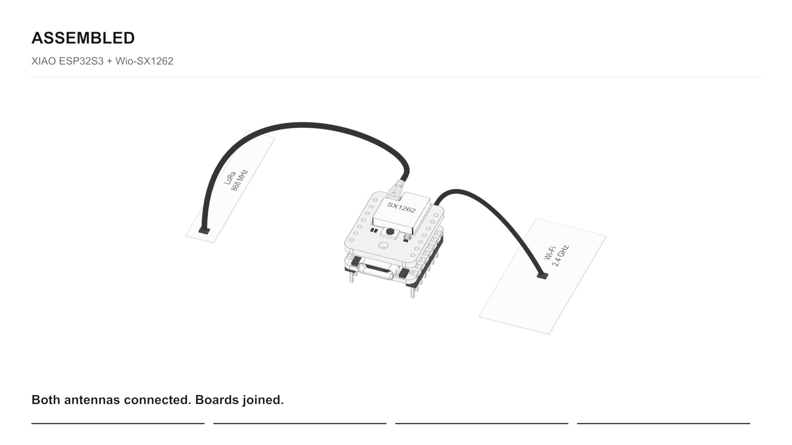
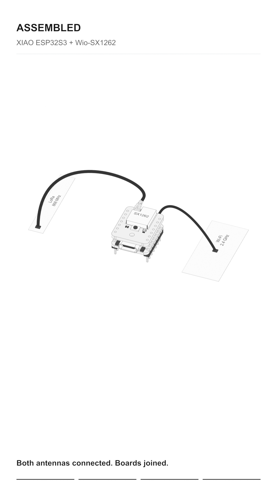

# Mesh kit assembly

Interactive assembly guide for XIAO ESP32S3 and Wio-SX1262.

[Get the XIAO ESP32S3 & Wio-SX1262 Kit from Seeed Studio](https://www.seeedstudio.com/Wio-SX1262-with-XIAO-ESP32S3-p-5982.html)

[Read the Seeed kit documentation](https://wiki.seeedstudio.com/wio_sx1262_with_xiao_esp32s3_kit)

[Open the scroll-controlled website](https://ykondrashyn.github.io/mesh-kit-assembly/)

Scroll to connect the Wi-Fi and LoRa antennas and join the boards. The website includes landscape and portrait artwork, circular connector close-ups, optional chapter stills and written assembly instructions.

## Rendered demo videos

Both videos are **17 seconds, 30 fps, H.264 MP4, with no audio**. They introduce the four labelled parts, connect each antenna, show the rear board connector, then return to the front of the assembled kit. All assembly artwork was rendered in Blender, with no AI-generated imagery.

Click a preview to open its video file, or use the direct MP4 download links.

| Landscape, 16:9 | Portrait, 9:16 |
| --- | --- |
| [](ppt-demo-assets/06-animation/assembly-showcase.mp4) | [](ppt-demo-assets/07-animation-portrait/assembly-showcase.mp4) |
| 1920 × 1080, 2.73 MB | 1080 × 1920, 2.54 MB |
| [Download landscape MP4](https://github.com/ykondrashyn/mesh-kit-assembly/raw/refs/heads/main/ppt-demo-assets/06-animation/assembly-showcase.mp4) | [Download portrait MP4](https://github.com/ykondrashyn/mesh-kit-assembly/raw/refs/heads/main/ppt-demo-assets/07-animation-portrait/assembly-showcase.mp4) |
| [Blender project](ppt-demo-assets/06-animation/_source/assembly-showcase.blend) · [Render and PowerPoint instructions](ppt-demo-assets/06-animation/README.txt) | [Blender project](ppt-demo-assets/07-animation-portrait/_source/assembly-showcase.blend) · [Render and PowerPoint instructions](ppt-demo-assets/07-animation-portrait/README.txt) |

For PowerPoint, download the desired MP4 and insert it as a video from your computer. Preserve its aspect ratio. Leave looping and rewind after playback disabled to retain the final assembled view.

## Local preview

```sh
cd assembly-scroll-site
python3 scripts/preview.py
```

Open [http://127.0.0.1:8766/](http://127.0.0.1:8766/).

See the [website README](assembly-scroll-site/README.txt) for development and validation details, and the [PowerPoint asset guide](ppt-demo-assets/README.txt) for the complete presentation package.

## GitHub Pages

The **Publish assembly website** workflow deploys only `assembly-scroll-site/dist`. It checks the timeline and loader tests and verifies all 2,526 exported frame hashes before publishing. The videos and other source assets remain available in this repository, outside the website deployment.

Relevant changes pushed to `main` deploy automatically. The workflow can also be run manually from the Actions tab. No custom domain is configured.

## Repository contents

The repository preserves the manual's original source, models, renders, videos and presentation assets together with the website and its tests. The initial commit captures the manual before the website improvements. Later commits separate responsive assets, loading improvements, fallback behavior, mobile interactions and validation.
